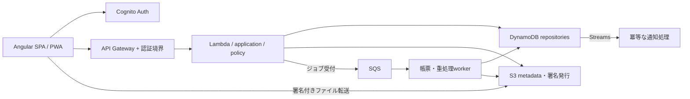

# Harvest モダン化設計・リポジトリ調査

初回調査日: **2026-10-23 JST**。調査基準は `harvest-webapp` (`547e928`) と `harvest-serverless-api` (`66d7d18`)。このディレクトリは両リポジトリを横断する設計・検証資料をwebapp側に集約して保存したものです。

**このREADME以下の調査結果・版数・未実施項目は初回調査時点の記録です。その後、アプリケーション・依存・lock・テスト・CI・配布スクリプトを更新しました。現在の実装、検証済み範囲、設計からの未達事項は [実装状況](implementation-status.md) を参照してください。AWS環境へのデプロイは実施していません。** 初回の脆弱性件数や旧ファイルパスを、更新後の実装への評価として扱わないでください。

個別監査報告には検討中の代替案も含む。採用方針・優先順位・移行時の保証は、この総合設計を正本とする。フロント・バックエンド・セキュリティ担当による統合後レビューも反映済み。

## 1. 結論

調査基準時点は **Angular 8 / TypeScript 3.4 / Amplify 1 / Python 3.6** を中心とする構成で、保守対象への更新が必要。ただし、バージョン番号だけを上げても改善は完了しない。認可の欠落、依存定義の不足、一覧取得の不具合、機能を守れていないテスト、再現できない配布手順を併せて直す。

推奨する方向は次のとおり。

1. **Angularを継続し、現行CLIで作る新しいアプリケーション基盤へ機能単位で移植する。** Material/CDK、typed API、認証adapter、明示的なプロジェクト状態に統一する。
2. **自作HTTP基盤をAWS Lambda Powertools＋Pydanticへ置き換える。** Middlewareの変更も許容して比較した結果、AWS SAM / Lambda / DynamoDB / S3 / Cognitoは現時点の第一候補とする。Pythonを更新し、自作コードを正式なpackageに整理、lockとターゲット環境ビルドを導入する。
3. **認可・課金・データ整合性の修正を先行する。** 並行して、画像・Excel・日本語ZIP等の回帰テストとCIを作る。
4. **重い生成処理とファイル転送を段階的に改める。** 生成ジョブ、S3直接転送、ページネーション、条件付き更新、イベントの冪等性を導入する。
5. **既存データと旧PWAを含めて移行する。** APIを追加してからクライアントを更新し、旧契約の削除を最後にする。

既存製品の継続は制約ではない。ユーザーからMiddleware差替え、および実装・レビュー・テストの反復まで許可を得た。FastAPI/ASGIはAPI開発体験や可搬性、PostgreSQLは横断集計・参照整合性、CDKは複数環境の共通構成、外部OIDC providerはSSO等に明確な利益がある場合の交換候補とする。現在のアクセスパターンと既存ユーザー・データの移行負担を比較し、まず自作HTTP基盤を置換する。単一帳票処理はSQS/Lambda、複雑な段階処理はStep Functions、Lambdaの時間・ディスク上限を超える場合はcontainer workerを選べる構造にする。

## 2. 調査の範囲と限界

| 領域 | 確認した範囲 | 調査結果 |
| --- | --- | --- |
| リポジトリ | 追跡ファイル FE 220 / BE 81、設定・ソース・テスト・スクリプト・README | [commit/ファイル種別の記録](evidence/repository-snapshot.json) |
| フロント構造 | 実装TS 76ファイル・4,465行、23 components、10 NgModules | [構造・業務互換性](audits/frontend-architecture.md) |
| フロント依存 | 全44直接依存、lockfile v1、推移依存、npm audit、現行版とpeer | [全44件の台帳](audits/frontend-dependencies.md) |
| バックエンド構造 | routesのPython 59ファイル。独自zipfileを除き6,315行。11 Lambda、23 URL、OPTIONS除外50 method events | [内部構造・データ整合性](audits/backend-architecture.md) |
| バックエンド依存 | 6 requirements、直接import、SAM/build配置、PyPI、runtime/wheels | [全直接依存と移行制約](audits/backend-dependencies.md) |
| 認証・認可・運用 | API→業務処理→SDK到達、ログ、IaC、デプロイ、イベント処理 | [セキュリティ・インフラ](audits/security-infra.md) |
| 品質 | 全spec、CI設定の有無、型検査/lint、テスト収集、shell構文 | [品質基盤・検証結果](audits/quality-tooling.md) |

実施したのは静的読解、既存環境での限定チェック、fake clientによるオフライン再現、npm/PyPI/公式資料の読み取り照会。全画面のブラウザ検証、production build、Lambdaビルド、デプロイ、実AWSリソース調査は未実施。インストール済みnode_modulesやdistを本番配布物と同一とは扱わない。

本番のIAM、API Gateway設定、S3公開状態、Cognito属性設定、外部CIの有無はリポジトリだけでは確定できない。「コードに定義がない」と「本番にも設定がない」を区別する。全経路の動的検証を終えたという意味ではない。

## 3. 先に直すべき問題

優先度は本設計の作業順であり、CVSS評価ではない。P0は基盤移行を待たず修正設計・回帰テストを開始するもの。

| 優先 | 問題と影響 | 根拠・確認方法 | 是正と完了条件 |
| --- | --- | --- | --- |
| P0 | 法人ユーザー無効化で呼出者ロール・対象法人所属を確認しない | BE `harvest/corporation.py:46` → `controllers/corporation_controller.py:119`。fakeで別法人ユーザーdisable到達 | actor/法人/対象所属をサーバーで照合。別法人・非管理者・保護対象の操作を拒否するテスト |
| P0 | 写真取得・採用がproject/target/photoの所属を照合しない | BE `controllers/photo_controller.py:67,195`。fakeで別project写真read到達 | DBにある写真参照と要求project/targetを完全一致照合。未知/他tenant IDを拒否 |
| P0 | テンプレート削除・生成が全tenantのprefixを部分一致検索 | BE `controllers/template_controller.py:285`、`generate_controller.py:296`。fakeで他project削除到達 | 許可scopeごとのexact ID→key解決。default読取専用、他tenantの利用・削除禁止 |
| P0 | token/password/署名URLがログに入り得る | BE `utils/request_decorator.py:45`、FE `signup.component.ts:41`等 | ログ許可項目を限定。成功/失敗とも秘密値なしを検証。既存ログの状況は別途確認 |
| P1 | Cognitoページ処理が重複・欠落し企業人数や課金に波及 | BE `drivers/cognito_driver.py:30,60,74`。抽出クラスの実行で再現 | 0/1/60/61人・複数ページを検証。集計は一意ユーザー数と一致。過去請求は自動訂正せず別途差分調査 |
| P1 | DynamoDB/S3の一覧が途中で切れ、生成・削除も欠落し得る | BE `drivers/dynamodb_driver.py:106`、`s3_driver.py:30` | 内部全件処理をiterator化、UIはcursor方式。複数ページ・空ページ後tokenあり・途中失敗を検証 |
| P1 | 写真5枚上限の前にS3保存、同時書込み条件が不十分 | BE `controllers/photo_controller.py:88`以降 | 上限/採用/最後の1枚を条件付き更新で保証。S3失敗・競合・再送後の整合性を検証 |
| P1 | 認証challenge完了を待たず、project/通知状態に競合 | FE `auth.service.ts:47`、`projects.service.ts:26`、`notifications.service.ts:23` | typed Session/ProjectContext。遅延応答・project切替・ログアウトで状態漏れを起こさない |
| P1 | 通知例外を握りつぶし成功応答 | BE `routes/notifications/dispatcher.py:25` | 部分バッチ失敗＋冪等性＋再試行先。成功分を重複送信せず失敗分を回復 |
| P1 | SAM依存配置とCodeUriが不一致、deploy失敗がexit 0になり得る | BE `template.yaml:67`、`deploy.sh:3,6,9` | lockからclean build、全handler import成功。build/validate/deployいずれの失敗も非zero |

BEの`harvest/`以下のパスは現行 `routes/site-packages/harvest/` を指す。FEの完全なパスと追加問題（日時変換、FileReader、forms、PWA等）は各監査報告に記載。

**Cognitoの再現結果:** 次ページtokenを返す60人のfake応答に対し、1,000回呼び出し・60,000件返却・一意60人だった。通常のlist_usersもtokenなしで同じ1人を1,000回取得し、tokenありでは0件を返す。[実行結果](evidence/cognito-pagination-reproduction.json)。本番の請求誤りを確認したものではない。

**依存監査:** npm auditは全体266 package件（critical 68 / high 143）、dev除外28件（critical 0 / high 21）。依存への伝播を含むpackage数で、独立した脆弱性数や悪用可能件数ではない。manifestのruntime分類自体にもPWA schematic等が混ざる。配信bundleの到達性を次段階で確認する。`audit fix --force`による一括変更は行わない。[全結果](evidence/frontend-npm-audit.json) / [dev除外](evidence/frontend-npm-audit-production.json)。

## 4. 採用する技術構成

以下は調査時点の候補固定値。registryのengine/peer、公式サポート表、wheelの存在を確認したが、アプリ全体での採用検証はこれから。実装時にlock solverとclean buildで確定し、リリース時にpatch/advisoryを再確認する。

| 項目 | 現行 | 推奨する到達点 |
| --- | --- | --- |
| Node / package manager | 版固定なし | Node 24 LTS（Angular要件24.15以上、環境観測24.19.0）。npm継続・版固定・`npm ci`、現行lock形式 |
| Angular | 8.1.0 | core/compiler/router等22.2.3、CLI/Material/CDK22.2.4。最新CLIのapplication builder |
| TypeScript / RxJS | 3.4.5 / 6.5.2 | **TS 6.0.3 / RxJS 7.8.2**。TS latest 7.0.2はAngular peer `>=6.0 <6.1`の範囲外 |
| Build | Webpack世代のbuild-angular | `@angular/build`22.2.4。独立Vite設定を重ねない |
| UI / state | Material8 + Bootstrap4 + lightbox、可変service | Material/CDK、機能別lazy、typed forms、UI stateはsignal、非同期/取消はRxJS |
| Auth | Amplify1、SDK v2直接宣言 | Amplify6.22.2のmodular Authをadapter化。未使用SDK v2/@types stub削除、間接v2残留も確認 |
| FE quality | TSLint/codelyzer、Karma/Jasmine、Protractor | ESLint10.13 + angular-eslint22.6、Prettier、Vitest5.0.5、Playwright1.64.1 |
| Python | 全11関数3.6 | **3.14第一候補**、既存CPU architectureを維持。Lambdaリージョン対応と帳票PoCで確定。問題があれば3.13を代替評価 |
| Python build | 手作業site-packages、lockなし | `pyproject.toml` + `uv.lock` + installable `src/harvest`、SAM CLI1.169.0をアプリ環境と分離固定 |
| AWS SDK | boto3未固定 | boto3/botocore1.43.117候補を同時解決し梱包。ランタイム内蔵版に依存しない |
| Excel / image | openpyxl/Pillow未宣言 | openpyxl3.1.5 / Pillow13.0.0。adapterと出力構造テスト、Lambda互換native wheels |
| その他Python | requests2.20、dateutil等未宣言 | 未使用requests削除。dateutilは2.9.0.post0候補（latest3はbotocore `<3`と衝突）。CSV文字コード/JWTは境界の再設計に合わせ整理 |
| BE quality | hello_world雛形のみ | pytest、Ruff、mypyをdev依存固定。botocore Stubber、必要箇所のDynamoDB integration |
| Infra | 部分的なSAMと手動設定依存 | SAM継続、環境parameter、関数別IAM、監視・backup・retentionを明示、既存資源を保持して取り込み |

Angular22は公式表でActive、Node26は調査日時点でまだLTS前のためNode24を基準とした。Python3.14はSAMのタグ固定ソースとAWS base image、Pillow cp314 wheelを確認済み。ただしこれらは実アプリの動作保証ではない。根拠URLと取得内容は依存報告・[evidence一覧](evidence/index.json)に保存。

Bootstrap、blueimp、Zoneは移植初期に必要な範囲で残せる。最終的に減らすが、ゾーンなしへの変更・画像API置換・全体CSS変更をフレームワーク更新と同時の必須条件にしない。新規UIはMaterial/CDKとCSS Grid/Flexで実装する。SSR導入、汎用state管理ライブラリ追加、arm64化は今回の必須目標に含めない。

## 5. 到達後の構造



2リポジトリは維持する。API契約はバックエンドの `contracts/openapi.yaml` を正本とし、schemaの版と生成物hashをフロントの生成DTO/clientに記録する。CIは互換性破壊と生成差分を検出。リポジトリ統合を前提にしない。

```text
harvest-webapp/
  src/app/core/{auth,http,config,pwa}/
  src/app/api/                      # 契約から生成したDTO・薄いclient
  src/app/features/{auth,projects,work,reports,notifications,corporation}/
  src/app/shared/{ui,files}/
  e2e/                             # Playwright

harvest-serverless-api/
  pyproject.toml / uv.lock / template.yaml / samconfig.toml / Makefile
  src/harvest/handlers/             # event・DTO・error response
  src/harvest/application/          # use cases・認可・transaction
  src/harvest/domain/               # 写真制限・権限・請求等の純粋な規則
  src/harvest/adapters/             # DynamoDB・S3・Cognito・Excel
  src/harvest/workers/              # 帳票・通知・必要な重処理
  contracts/ / tests/{unit,contract,integration,fixtures}/
```

フロントは`SessionFacade`でunknown/anonymous/challenge/authenticatedを明示し、SDKの生オブジェクトを画面に広げない。`ProjectContext`は選択IDと読取専用状態を保持し、APIメソッドはprojectId等を毎回引数で受ける。読込はproject切替で取消し、更新は二重送信を抑制。localStorageのID復元後には権限を再取得する。

バックエンドは認証主体・法人・権限を不変のrequest contextとして渡す。AWS clientは再利用できるが、user_id/project_idを持つmutable controllerをグローバル化しない。APIから帳票依存を遅延/分離し、最初は共有artifactでもよいが最終的にはHTTPと帳票workerを別梱包にする。

## 6. 契約・データ移行の設計

### 認証・認可

- Cognito user pool、既存user ID、プロジェクトUUID、短縮参加コードを維持する。`cognito:username`を`sub`へ単純置換しない。変更が必要なら対応表とデータ移行を独立設計する。
- 最初は既存ID token契約を保ち、管理されたCognito authorizerまたは厳密な検証adapterと、アプリ内の資源所属検証を整える。issuer/audience/token_use/expiry、header大小文字、missing tokenをテスト。
- JWTの期限切れと、ユーザー無効化・ログアウトによる失効は分ける。署名検証やauthorizerだけでは発行済みtokenの即時拒否を保証しない。高権限操作はサーバーの有効状態を照合し、その他もtoken TTL・状態cache TTL・必要なdenylistにより無効化の反映期限を定義する。
- access token/scopes/Bearerへの変更はフロントとAPIで別段階に行う。access tokenには既存ID tokenと同じprofile/custom claimsがあるとは限らず、法人識別をtokenの形に依存させない。
- interceptorはAPI origin/pathに限定し、S3署名URLや外部URLへJWTを送らない。CORSは環境ごとのorigin、認証エラー応答、OPTIONSまで一貫させる。
- owner/admin/worker/reporter/guest、参加申請・拒否・旧status欠落を網羅する。ownerへの昇格、最後のowner削除、法人管理者無効化のルールも明文化する。

### 写真・CSV・テンプレート

- 第一段階は既存base64 APIを維持して所属・サイズ・実体検査と条件付き更新を修正する。
- 次段階でupload session → 隔離S3 prefix → 検証 → finalizeを導入。確定前の予約枠も含め同時5枚上限を守り、写真件数は検証成功後に更新する。sessionとfinalizeは冪等化し、期限切れ予約と孤児uploadを清掃する。
- 署名は短命、keyはサーバー決定。必要に応じサイズを制約できるpresigned POSTを用い、Content-Typeだけを信用しない。画像の総バイト数/ピクセル数、XLSXの展開量/構造に上限を設ける。
- 署名が有効な間は同じupload keyへ再送できるため、検証後の上書きも考慮する。隔離領域のversioningを有効にして検証対象VersionIdを固定し、その版をクライアントが書けない確定keyへコピー、またはimmutableなversionを参照してからDBを確定する。検証したbytesと利用するbytesが同一であることを保証する。
- 既存S3 UUIDキーは直ちに移動しない。DB参照で所有を検証し、新規keyにproject prefixを導入後も旧keyを読める期間を設ける。templateはdefault/user/projectのscopeとexact keyで解決する。
- CSVのUTF-8/CP932、日本語列、階層参照・重複・循環、写真EXIF orientation・1280px・JPEG品質0.85、採用写真/最後の1枚の削除制限を回帰条件にする。

### 帳票ジョブ

- 追加API案: `POST /projects/{project_id}/generation-jobs` → `202 {job_id,status}`、`GET .../{job_id}` → status/result、成功時のdownload URL取得。既存`/generate`の意味は一度に変更しない。
- jobはactor/project、設定snapshot、入力の版または対象写真ID、idempotency key、状態、進捗、error code、output key、expiryを保存。queued/running/succeeded/failedを条件付き遷移させる。
- DynamoDBへのjob保存とSQS送信は原子的でない。outbox/Stream発行または未送信job再送で取りこぼしを防ぐ。重複配信・worker途中停止はjob leaseと冪等出力で回復する。
- 受付時・実行時・結果取得時に必要な権限とproject状態を確認。プロジェクト削除や権限剥奪後は新たなdownload URLを発行しない。発行済みS3署名URLは通常期限まで使えるため短いTTLとし、即時拒否が必要なデータは認可付き配信経路を選ぶ。SQS再試行、DLQ、保存期間、ジョブの滞留監視を定義する。
- SQS/Lambdaから開始し、最大入力の時間/メモリ/tmpを測る。Lambda上限を超える処理だけ別workerを検討する。UIではHTTP timeoutを生成失敗と同一視しない。
- Excelはセル/画像anchor/結合/改ページ/印刷設定で比較し、ZIP byte一致を要求しない。独自zipfileの実import元を確認してから標準UTF-8へ移す。CP932が必要なら限定adapterとして保持し、表現不能文字を黙って捨てない。

### DB・課金・日時

- Projects/Roles/Places/Targets/Notifications/Billsと既存キーを維持する。job/metadata/version/GSIの追加はexpand→backfill→検証→切替→旧経路削除の順。
- DB内で完結する複数更新はtransaction、S3/Cognitoを跨ぐものは再開可能な処理と補償を設計する。削除は状態を先にmarkし、認可情報を清掃完了前に消さない。
- API一覧のcursor化は新しい契約として追加。既存の配列応答を突然`{items,next_cursor}`へ変えない。内部バッチは全ページを処理し、未処理項目を再試行する。
- 請求レコードは法人＋対象月を一意キーとし、月内ユーザー追加等の更新は別のevent IDで重複排除する。現行の月内人数増加による更新・減少時に下げない計算規則を確認して保持し、単純な月1回のcreate-onlyに変えない。ユーザー重複・同時登録・失敗再実行、月末・年越し・閏年・25/26日境界をテストし、料金や税率の業務変更を混ぜない。
- 新規timestampは最終的にUTCのoffset付きに統一する。先に全readerを旧naive/新offset両形式対応へ配布し、その版を切戻しの下限としてからwriterを変更する。新readerが旧値を読めるだけでは、canaryやrollback中の旧readerを守れない。日付のみの値は別型。表示はAsia/Tokyoを明示。既存cronは26日00:10 UTC＝09:10 JSTであり、締日の正式な業務定義を確認してから変える。

## 7. 実装順序とPR単位

新Angular基盤への移植を第一案とする。着手時にログイン→project一覧の1機能で、Material/Amplify/API/PWA/ビルドを検証する。難航する具体的な理由が見つかった場合のみ、旧Angularをmajor順に更新する経路を比較する。いきなりpackage.jsonを8→22へ書き換えて解決扱いにしない。

M06〜M09は新基盤を別のpreview環境に配置し、既存URLとAPI契約を保って機能ごとに移植・比較する。必要機能が揃ってからM14でアプリ全体の配信を切り替える。Angular8と22を同一アプリに混在させる設計ではない。部分的な本番公開が必要になった場合は、origin/path、認証、Service Worker scopeを追加設計する。

| ID / 段階 | 具体的な成果 | 依存 | 必須の受入条件 |
| --- | --- | --- | --- |
| M01 調査固定 | 合成API/認証/role/CSV/画像/帳票fixture、既知失敗一覧 | なし | 守る仕様と既知不具合を分離、AWSなしで再現できる |
| M02 優先是正 | 3系統の資源認可、秘密ログ停止、限定JWT検証 | M01の該当fixture | 他tenant操作・秘密ログ・不正tokenを否定テスト |
| M03 正確性 | Cognito/Dynamo/S3 paginationと課金人数検証 | M01 | 2ページ以上で重複/欠落なし、SDK失敗検出 |
| M04 BE再現基盤 | src package/pyproject/uv lock、SAM build、deploy exit修正 | M01 | clean buildと11 handler import、import時外部通信なし |
| M05 帳票互換 | openpyxl/Pillow/ZIP adapter、Python3.14 PoC | M04 | basic_1/basic_2・代表template・日本語ZIP/画像/日付が合格 |
| M06 FE新基盤 | Node24/Angular22/build/ESLint/Vitest、login+project一覧移植 | M01 | strict型・peer整合・認証challenge・API契約・比較画面合格 |
| M07 CI | FE/BE lint/type/unit/contract/build、Playwright、依存検査 | M04/M06 | fresh checkoutで成果物生成、失敗gate、trace/結果保存 |
| M08 API境界 | OpenAPI、DTO、error mapping、request context | M02/M04 | 既存正常契約とエラー番号の互換、生成client差分検知 |
| M09 FE機能移植 | work/photos→reports→notifications/corporation、typed forms/state | M06/M08 | project切替・role別操作・画像・キーボード/モバイル回帰 |
| M10 整合性 | 条件付き更新/transaction、写真上限、イベント冪等性 | M03/M04 | 競合/重複/部分失敗を再現して回復 |
| M11 ファイル転送 | upload session・署名・検証/finalize・旧API adapter | M08/M10 | サイズ超過/偽画像/再送/期限切れ/並列上限が安全 |
| M12 生成ジョブ | queue/worker/status API/進捗UI、outboxまたは再送 | M05/M08/M10 | 送信失敗/重複/worker停止から回復、最大入力で計測 |
| M13 IaC整備 | 既存資源inventory、parameter/IAM/log/backup/alarms | M04、実環境の読み取り確認 | 予期しないデータ資源置換なし、環境別に再現可能 |
| M14 配布と切戻し | OIDC・不変artifact・alias/canary・旧PWA資産保持 | M07/M09/M13 | stagingで新旧clientとrollbackをリハーサル |
| M15 整理 | 旧Angular/toolchain、未使用依存、AppleDouble、暫定adapter、README更新 | 各移行の完了 | 旧client利用の観測後に旧契約撤去、SBOM/依存更新bot稼働 |

M02/M03の回帰修正、M04/M05のバックエンド移行、M06のフロント移行は担当を分けて並行できる。各行が大きければ認証・写真・帳票等でさらにPRを分ける。共通schema変更を先に確定し、同じ巨大PRでDB・runtime・UI・認証tokenを全て変えない。

作業量は実装PoCと既存データの確認前には精度が出ない。特にユーザー作成Excel、CP932 ZIP、現場端末、本番IaCとの差分が増減要因。M05/M06完了後に見積もりを更新する。

## 8. 品質とリリースの完了条件

今回の既存チェックではアプリTS型検査は成功、spec型検査は13ファイル15件の参照切れで失敗、lintも失敗。FE 36ケース中34ケースは生成/存在確認、E2Eは旧Welcome表示のみ。BEはhello_world雛形1件で参照先がなく、選択Pythonにpytestも未導入のため収集不能だった。現在のテスト成功数を機能品質の根拠にしない。

必須gateは以下とする。

- **再現性:** 固定toolchainとlockからFE/BE成果物をclean環境で生成、全handler import成功。SAM CLI依存をLambdaへ混入させない。
- **認証/認可:** 未認証・期限切れ・異issuer/audience/token_use、法人/全role/所有関係/参加状態のmatrix。失効・ユーザー無効化は定めた反映期限と状態確認方針を検証。秘密値のログ出力なし。
- **業務E2E:** ログイン→project→階層→写真→Excel、法人管理、通知、session切れ、project切替、旧PWA更新。PRはmock API、stagingは専用tenantの実API。
- **データ/非同期:** 5枚同時制限、ページ境界、batch未処理、重複イベント、S3/DB失敗、課金年月境界、job投入失敗と再試行。
- **ファイル互換:** EXIF/縦横/破損/巨大画像、CSVの日本語・階層、XLSX構造/印刷・画像位置、日本語ZIP。利用環境での代表帳票目視も行う。
- **運用:** 構造化ログ、request/job ID、latency/error/queue age/失敗数/tmp使用の監視、backup復元・DLQ再処理・rollbackの手順。
- **配布:** 同じartifactをstagingから昇格。hash assetsは長期immutable、index/ngsw manifestは再検証。新assetsを先に置き旧assetsを保持。入力中の強制reloadを避ける。
- **切戻し:** M02の認可・機密ログ修正を含み、導入済みtimestamp/job/予約枠/metadataと互換な版を下限とする。既知の欠陥がある版へ戻さない。新旧reader/writer混在を検証し、アプリのrollbackがデータ変更まで巻き戻すと考えない。データ復旧は別の検証済み手順とする。
- **依存保守:** SBOMとruntime/bundle到達性を確認。未対応の重大な問題は根拠・担当・期限を記録。更新botは1つ選びAngular関連をgroup化、CIで継続更新する。

coverage率だけを成功条件にせず、認可・課金・生成の重要分岐を守る。性能は初期bundle、project一覧/写真表示、画像変換、帳票のp95、メモリ/費用をbaseline化し、移行での悪化を検出する。現時点で未測定の数値目標を達成済みとはしない。

## 9. 切替前に確認する事項

これらは設計・オフライン実装の開始を妨げないが、それぞれの切替前に解決する。

| 確認事項 | 確認時期・方法 | 初期方針 |
| --- | --- | --- |
| 本番artifact/runtime/IAM/authorizer/各資源の管理元 | M04/M13で読み取りinventoryと差分確認 | チェックアウトを本番の完全な写しとみなさない |
| 既存資源のCloudFormation import可否 | M13の変更セット作成前 | Retain、import非対応はparameter参照。資源再作成を避ける |
| 現場端末のOS/ブラウザ・カメラ・offline用途 | M06/M09の受入前 | Angularの対応範囲と照合。PWA継続、offline編集を勝手に追加しない |
| 利用中Excel/CP932 ZIP・APIの他利用者 | M05/M08の契約確定前 | 代表fixture、旧契約の互換期間を設ける |
| 最大project/写真/帳票サイズと性能 | M10/M12で計測 | 上限は測定と業務要件で確定 |
| 請求締日/タイムゾーン/過去人数への影響 | M03・課金変更前 | 料金を変えず、差分をdry-runで提示 |
| ロール昇格・最終owner・法人管理者の保護条件 | M02/M08で仕様化 | 明示許可のみ、既存正常操作と比較 |
| ログ内の実際の機密値・コメント例の実利用 | M02後の運用確認 | リテラル例を実資格情報と断定しない。露出確認に応じて対処 |

実装の着手順は **M01の重点fixtureとM02/M03の優先修正 → M04/M06の再現可能な基盤 → 機能移植・整合性 → ジョブ/ファイル転送 → 安全な切替** とする。これにより、保守対象への更新と実際の不具合解消をそれぞれ検証しながら進められる。
